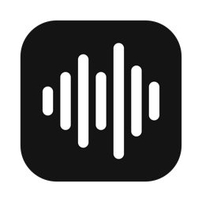
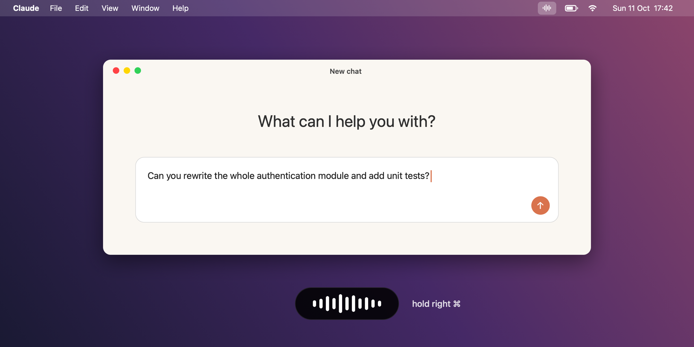
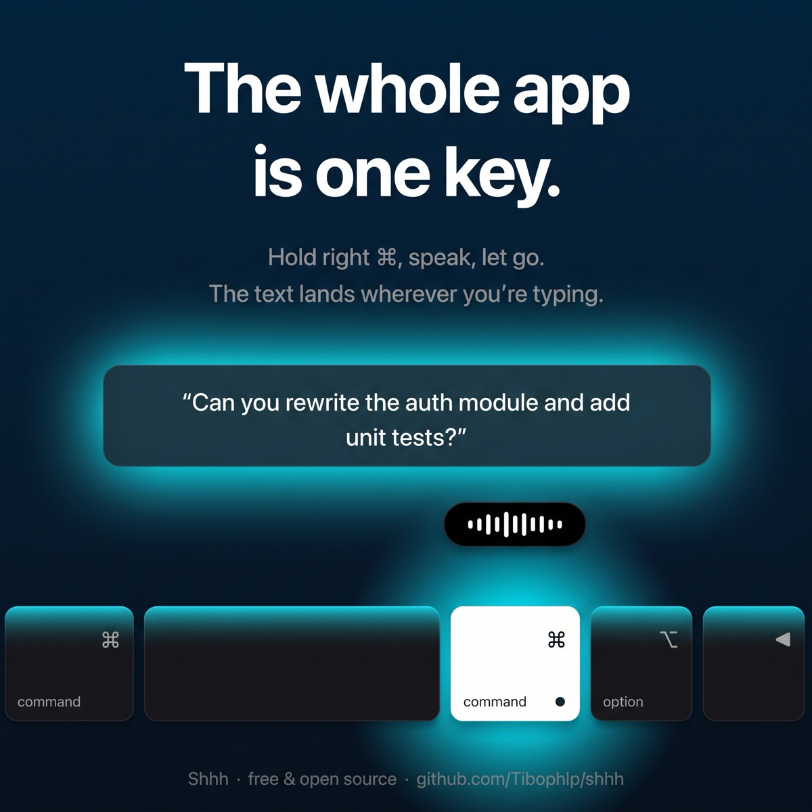
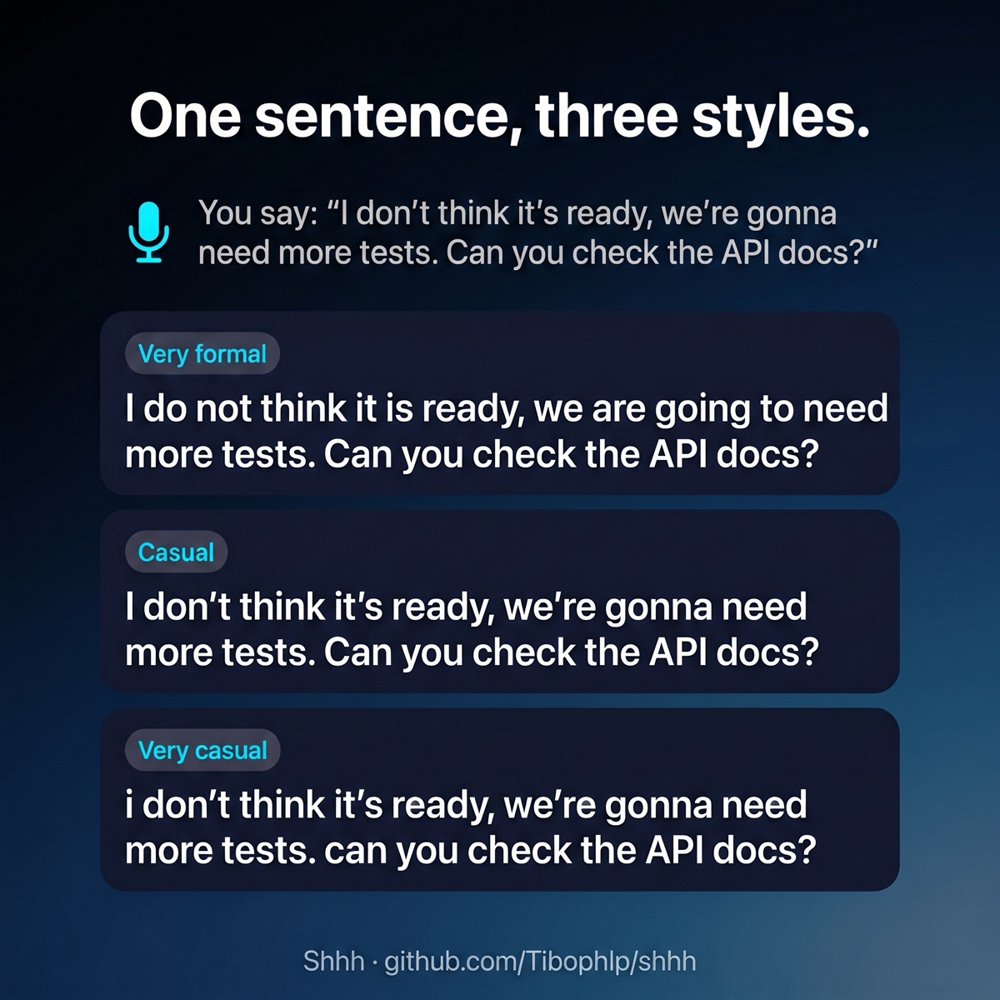
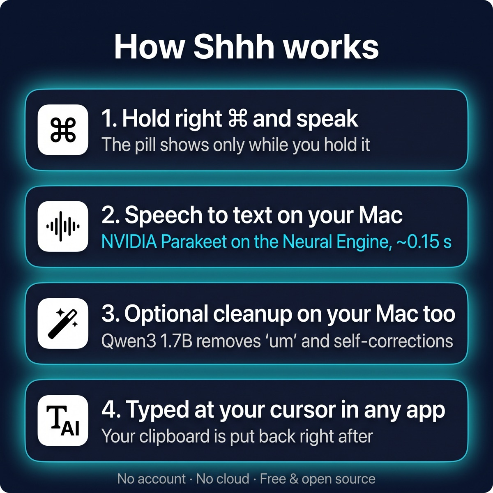

<p align="center">
  
</p>

<h1 align="center">Shhh</h1>

<p align="center">
  <b>Hold right ⌘. Talk. Let go.</b><br>
  Your words are typed wherever your cursor is: fast, private, entirely on your Mac.
</p>

<p align="center">
  <a href="https://github.com/Tibophlp/shhh/releases/latest"></a>
  
  
  
</p>

<p align="center">
  
</p>

---

I built Shhh to talk to AI tools instead of typing long prompts. It does one thing: speech to text, at your cursor, in any app. No account, no cloud, no subscription, and no bar on your screen when you're not using it.

## Features

- **Hold to talk.** Hold the right ⌘ key, speak, let go. The text appears in the focused app.
- **Invisible until needed.** A small pill shows at the bottom of the screen only while you're holding the key.
- **Fast.** Speech is transcribed in a fraction of a second on the Apple Neural Engine.
- **English and French** (and 23 other European languages), detected automatically. No setting to switch.
- **Your writing style.** Very formal, casual or very casual, applied instantly.
- **Picks the right microphone.** AirPods when they're in, your Mac otherwise. With the lid closed on an external monitor, it switches to your iPhone's microphone.
- **Optional AI cleanup.** Removes "um", repeated words and spoken self-corrections, also on-device.
- **Private.** Audio never leaves your Mac. Nothing is stored.
- **Doesn't get in the way.** ⌘C, ⌘Tab and every other shortcut still work. Your clipboard is restored after each paste.

## Install

### Download

1. Download **Shhh.zip** from the [latest release](https://github.com/Tibophlp/shhh/releases/latest), unzip it, and move **Shhh.app** to your Applications folder.
2. Open it. Shhh isn't notarized by Apple, so macOS blocks the first launch. Go to **System Settings → Privacy & Security** and click **Open Anyway**.
   Or run this once in Terminal:
   ```bash
   xattr -dr com.apple.quarantine /Applications/Shhh.app
   ```

### Build from source

Needs Xcode (for the Swift toolchain).

```bash
git clone https://github.com/Tibophlp/shhh.git && cd shhh
./scripts/make-signing-cert.sh   # optional: keeps permissions across rebuilds
./scripts/build.sh --install     # builds, copies to /Applications and launches
```

### First launch

Shhh asks for two permissions:

| Permission | Why |
| --- | --- |
| **Microphone** | To hear you. Only used while right ⌘ is held. |
| **Accessibility** | To notice the right ⌘ key and paste the text into other apps. |

The speech model (~600 MB) downloads once on first launch. A waveform icon then appears in the menu bar and you're ready.

## Usage

<p align="center">
  
</p>

| Do this | What happens |
| --- | --- |
| Hold **right ⌘** and talk | Recording. The pill appears at the bottom of the screen. |
| Let go | The text is typed at your cursor. |
| Tap right ⌘ quickly | Nothing. Only a real hold records. |
| Press another key while holding | Recording is cancelled, and your shortcut works as usual. |

The menu-bar icon has these options:

- **Writing style**: very formal, casual or very casual (see below).
- **Microphone**: Automatic, or a specific microphone.
- **AI cleanup**: turn the cleanup pass on or off.
- **Copy last transcript**: get your text back if the cursor wasn't in a text field.
- **Launch at login**
- **Quit**

## Writing style

<p align="center">
  
</p>

Casual is the default. Very formal expands contractions and slang ("gonna" becomes "going to") and always ends with punctuation. Very casual is all lowercase (acronyms like API stay) with no final period. Casual leaves your words as spoken.

## Microphone

**Automatic** (the default) chooses for you, in this order:

1. Headphones or an external mic: AirPods, a USB mic, a wired headset, a webcam or monitor mic.
2. Your Mac's built-in microphone.
3. **Lid closed?** The built-in mic is switched off when a MacBook is closed, so Shhh uses your iPhone's microphone instead (Continuity: same Apple ID, iPhone nearby).

You can also pick a specific microphone from the menu. Shhh remembers it and uses it whenever it's connected, and falls back to Automatic when it isn't. With the lid closed, the built-in one is greyed out. Virtual microphones (Teams, Zoom, loopback drivers) are hidden.

## AI cleanup

Off by default. Turn it on from the menu bar. It downloads a small local model (Qwen3 1.7B, ~1.1 GB) and adds about half a second.

| You say | Shhh types |
| --- | --- |
| Um, can you refactor the login function so that it uses async await? Actually no, rewrite the whole authentication module and add unit tests. | Rewrite the whole authentication module and add unit tests. |
| Okay, so the plan is we refactor the auth module first, then we, you know, add tests, and then, I mean, after that we can deploy it on Friday. No wait, on Thursday. | Okay, so the plan is we refactor the auth module first, then add tests, and then deploy it on Thursday. |
| Je voudrais que tu, euh, regardes le fichier et que tu me dises si, genre, il y a des bugs. | Je voudrais que tu regardes le fichier et que tu me dises si il y a des bugs. |
| Can you make the the header sticky? | Can you make the header sticky? |
| What is the capital of France? | What is the capital of France? |

**It only ever deletes words.** It never rewrites, translates or answers your prompt. If the model's output adds or changes a word, or drops real words when you didn't correct yourself, Shhh pastes your original words instead.

## How it works

<p align="center">
  
</p>

```
right ⌘ held ─▶ microphone ─▶ Parakeet speech model ─▶ [AI cleanup] ─▶ writing style ─▶ paste at cursor
```

| | |
| --- | --- |
| Speech to text | [NVIDIA Parakeet](https://huggingface.co/FluidInference/parakeet-ultra-coreml) on the Neural Engine, via [FluidAudio](https://github.com/FluidInference/FluidAudio) |
| Cleanup | [Qwen3 1.7B](https://huggingface.co/Qwen/Qwen3-1.7B) via [llama.cpp](https://github.com/ggml-org/llama.cpp), prompted as a copy-editor, with a delete-only safety check |
| Microphone | Core Audio device list, lid state read from IOKit (`AppleClamshellState`) |
| Typing | Clipboard + ⌘V into the focused app, then your previous clipboard is restored |
| App | Native Swift, about 1,500 lines, no dependencies beyond the two above |

<details>
<summary><b>Project layout</b></summary>

```
Sources/Shhh/
  AppDelegate.swift      menu bar, permissions, dictation flow
  HotkeyMonitor.swift    right ⌘ detection
  AudioRecorder.swift    microphone capture
  AudioDevices.swift     microphone list, Automatic choice, lid detection
  WritingStyle.swift     very formal / casual / very casual
  Transcriber.swift      speech to text
  TextCleaner.swift      optional AI cleanup
  TextInserter.swift     paste + clipboard restore
  RecordingPanel.swift   the pill
  Watchdog.swift         time limit for audio-system calls
  CommandLineTool.swift  terminal test modes (below)
scripts/
  build.sh               build Shhh.app (--install: install and launch, --release: zip for GitHub)
  make-signing-cert.sh   local signing certificate
  make-icon.swift        regenerate the app icon
```

Test the pipeline without the app:

```bash
BIN=$(swift build -c release --show-bin-path)
$BIN/Shhh --transcribe recording.wav
$BIN/Shhh --clean "Um, let's meet Monday, actually no, Tuesday."
$BIN/Shhh --style veryFormal "I don't think it's ready."
$BIN/Shhh --microphones            # what Automatic would pick right now
$BIN/Shhh --record 3               # record 3 s from it and transcribe
```

</details>

## Troubleshooting

<details>
<summary><b>Nothing happens when I hold right ⌘</b></summary>

Make sure Shhh is enabled in **System Settings → Privacy & Security → Accessibility**. If you rebuilt or updated the app, toggle it off and on again; Shhh picks the key back up within a few seconds. Password fields and some apps (password managers, terminals with Secure Keyboard Entry) block keyboard monitoring on purpose: while one does, the menu-bar menu names it.
</details>

<details>
<summary><b>Shhh beeps when I hold right ⌘</b></summary>

Something is missing, and the menu-bar menu says what: the speech model is still downloading, Microphone access isn't granted, or no microphone is available (for example the lid is closed with no iPhone or headphones around). It also beeps if macOS's audio system doesn't respond within a couple of seconds, which can happen while a device like an iPhone microphone is connecting or dropping out. It also beeps after you let go if the microphone sent no audio. Shhh stays usable and simply tries again on your next press.
</details>

<details>
<summary><b>The text didn't appear</b></summary>

The cursor needs to be in a text field when you let go. Use **Copy last transcript** from the menu bar to get the text back.
</details>

<details>
<summary><b>The first word is sometimes cut off</b></summary>

The microphone takes a split second to start. Wait a beat after pressing right ⌘ before you speak, especially with Bluetooth headphones.
</details>

<details>
<summary><b>The iPhone microphone takes a moment</b></summary>

The iPhone's microphone starts about 3 seconds after you press right ⌘, but it buffers everything, so nothing you say is lost. Shhh just waits for it to catch up after you let go. Keep the iPhone close: it hears whatever is around it.
</details>

<details>
<summary><b>Where are the models stored?</b></summary>

The speech model is in `~/Library/Application Support/FluidAudio`, and the cleanup model in `~/Library/Application Support/Shhh`. Delete those folders to remove them.
</details>

## Credits

Built on [FluidAudio](https://github.com/FluidInference/FluidAudio) (Apache 2.0), NVIDIA Parakeet (CC-BY-4.0), [llama.cpp](https://github.com/ggml-org/llama.cpp) (MIT) and [Qwen3](https://huggingface.co/Qwen/Qwen3-1.7B) (Apache 2.0).

Inspired by Wispr Flow. Not affiliated with Wispr.

## License

[MIT](LICENSE)
